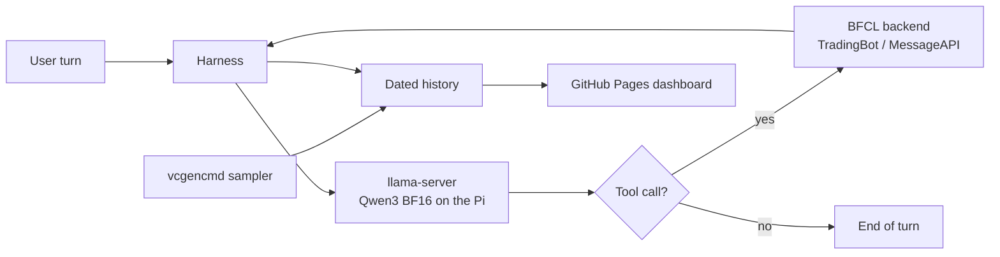
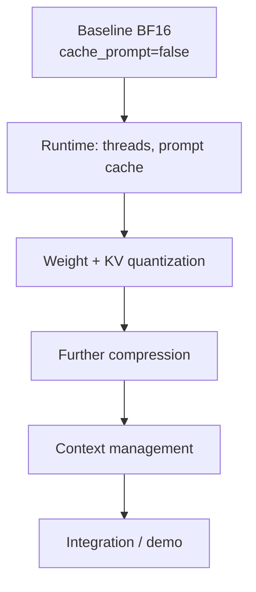
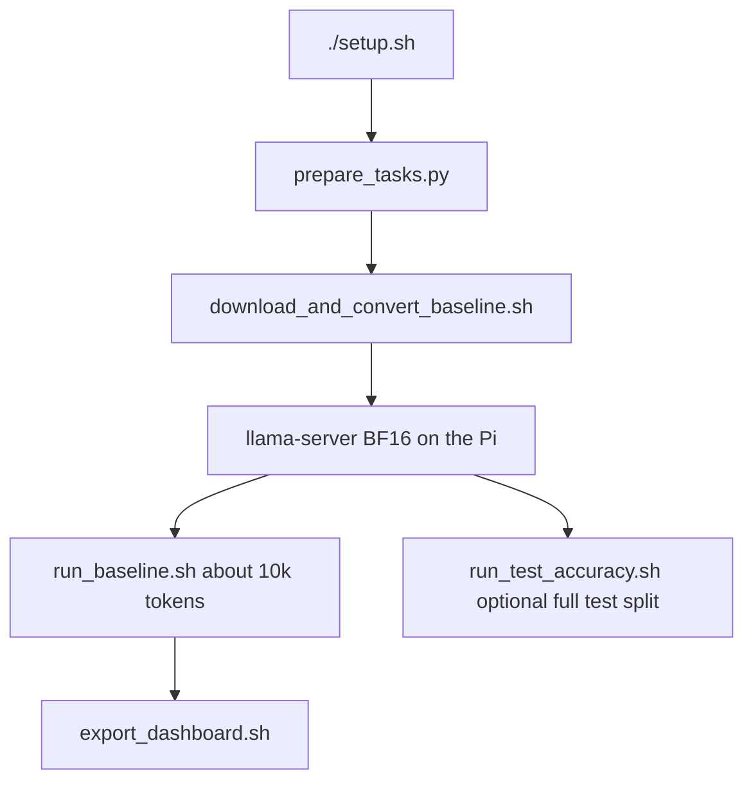

# Long Context Tool-Calling Agent

AI624 · AI on Edge Devices · Fall 2026  
**Track A — Project A1** · 8 GB Raspberry Pi 5

On-device multi-turn tool calling with Qwen3 through [llama.cpp](https://github.com/ggml-org/llama.cpp) `llama-server`. Sessions grow to tens of thousands of tokens as tool outputs are appended; the agent must still emit a valid call at the end.

**Dashboard:** [wajahatriaz.github.io/g7a1-ai-edge-devices-project](https://wajahatriaz.github.io/g7a1-ai-edge-devices-project/)  
**Presentation:** [docs/Presentation.md](docs/Presentation.md)

## Table of contents

1. [Overview](#1-overview)
2. [System diagram](#2-system-diagram)
3. [Milestones and progress](#3-milestones-and-progress)
4. [Tool subset and tasks](#4-tool-subset-and-tasks)
5. [Requirements](#5-requirements)
6. [Setup](#6-setup)
7. [Week 1 workflow](#7-week-1-workflow)
8. [Measurement notes](#8-measurement-notes)
9. [Repository layout](#9-repository-layout)

---

## 1. Overview

| | |
|---|---|
| **Runtime** | `llama.cpp` / `llama-server` (every token on device) |
| **Model family** | Qwen3, full attention in every layer (Qwen3.5 hybrids are out of scope) |
| **Baseline** | Qwen3-1.7B BF16, `cache_prompt: false`, thinking on, **16k** cache (`-c 16384` per [docs/Project_Description_AI624_2026.pdf](docs/Project_Description_AI624_2026.pdf)). **32k** does not fit 8 GB with BF16 weights. |
| **Tools** | ~20–30 BFCL multi-turn functions, long-context mode, must include TradingBot |
| **Out of scope** | Multi-agent orchestration; model served from another machine |

Inference, latency, memory, power, and held-out accuracy are measured on this Raspberry Pi 5. The talk outline, diagrams, and references are in [docs/Presentation.md](docs/Presentation.md).

### Baseline rules (before any optimization)

- Qwen3-1.7B (or the 2–4B member of the family) in BF16
- 16k context (fits in 8 GB). On the Pi, time a session that processes about 10k tokens. A stateless resend much larger than that, such as ~36k tokens at ~1.4 tok/s, is about 7 hours and is prohibitively long for the baseline. Later experiments (FP16, prompt caching, quantization) are what should make those sessions feasible.
- Stateless client: full history resent every turn, prefix caching **off**
- All tool schemas in the system prompt
- Thinking on, which is the Qwen chat-template default. Sampling is Qwen's thinking-mode setting: temperature 0.6, top-p 0.95, top-k 20. Non-thinking mode skipped `fund_account` after login.
- Flash attention left at llama-server's default, `--flash-attn auto`

`llama-server` caches prompt prefixes by default. The baseline client must send `cache_prompt: false`. BF16 stays the baseline. If decode stays near 1.4 tok/s, an FP16 conversion is the first improvement to report, because the Pi has faster FP16 instructions. Do not replace the baseline weights with that conversion. Prompt caching is the next serving change. Score the full test split on the Pi with `./scripts/run_test_accuracy.sh` when you are ready for a long run.

---

## 2. System diagram

Each user turn: the model emits a tool call → the tool runs locally via BFCL backends → the result is appended to the chat context → the model continues.



The sampler runs beside the harness for the whole command. The client resends the full history on every turn and sets `cache_prompt: false`.

Improvement lineage (kept / discarded steps, same held-out split):



---

## 3. Milestones and progress

Each change is applied on top of the last accepted configuration. Every step is measured on the same held-out split and marked **kept** or **discarded**. Discarded steps stay in the lineage.

| When | Due | Status | Deliverable |
|---|---|---|---|
| Week 1 presentation | 29 Nov 2026 | In progress on the Pi | Tool subset, trace set, harness; baseline characterized on the Pi |
| Week 2 presentation | 6 Dec 2026 | Not started | Prompt caching; weight and KV-cache quantization |
| Final presentation, demo, viva | 20 Dec 2026 | Not started | Further compression, context management, live demo |
| Code and report | 24 Dec 2026 | Not started | Documented code and written report |

### 3.1 Week 1 checklist

Legend: `[x]` done · `[ ]` still open. All metrics and accuracy scoring use this Raspberry Pi 5.

#### Infrastructure

- [x] Repo layout, `setup.sh`, lean `.venv`, `.venv-convert`
- [x] Submodules: `third_party/llama.cpp` (`d1eb0de`), `third_party/gorilla`
- [x] Native `llama-server`, `llama-cli`, `llama-quantize`, and `llama-imatrix` built on this Pi 5
- [x] Download `Qwen/Qwen3-1.7B` and convert `models/qwen3-1.7b-bf16.gguf`
- [x] Serve BF16 on the Pi (`127.0.0.1:8080`, `-c 16384`, `-np 1`, `-t 2`, `-tb 4`)
- [x] Dated power and thermal traces, GitHub Pages dashboard
- [x] TradingBot long-context filler cap in the shared `long_context.py` (`setup.sh` reapplies it)

#### Task 1 — tool subset and long session

- [x] Fixed subset: TradingBot (20) + MessageAPI (10) = 30 tools
- [x] BFCL long-context tasks for that subset (33 tasks)
- [x] Train (26) / test (12) hold-out
- [x] Five project long tasks; two early-detail tasks sit in the test split
- [ ] A finished session whose tool output is in the manual's 16k–32k range, after the filler cap (median tool context should fall near 8–11k tokens)

#### Task 2 — client harness

- [x] `src/a1_agent` harness (client, BFCL backends, parse/validate)
- [x] Per-turn token and timing logs, call validity
- [x] `cache_prompt: false`, schemas in the system prompt
- [x] Thinking on, with Qwen thinking-mode sampling (temperature 0.6, top-p 0.95, top-k 20)
- [ ] A finished Pi harness log on a held-out test task (`pi_scenarios.session` in `baseline.yaml`, default `multi_turn_long_context_118`)

#### Task 3 — baseline characterization

- [ ] Prefill/decode sweep at 512, 2048, and 4096 (`scripts/characterize_baseline.py`), with power and temperature
- [ ] Peak memory, bandwidth-bound decode check, and a thermal summary for that run
- [ ] Full held-out test split on the Pi (`./scripts/run_test_accuracy.sh`)
- [ ] Sessions well above about 10k processed tokens, once FP16 or prompt caching makes them feasible

---

## 4. Tool subset and tasks

Configured in [`configs/tool_subset.json`](configs/tool_subset.json).

| Backend | Tools | Role |
|---|---|---|
| TradingBot | 20 | Required. Long-context mode appends filler after the real records. |
| MessageAPI | 10 | Second BFCL backend; brings the set to 30 tools. |

Qwen3 tokenizes digits separately, so the uncapped TradingBot filler is much longer than the ~11k tokens named in the project description. A course note measured about 31.6k tokens for one `get_stock_info` and about 49.3k for `get_transaction_history`, with TradingBot sessions at a median of 32–36k tokens. `setup.sh` caps the filler lists at the end of `long_context.py` (`MA` and watchlist 500, transaction history 100). That file is the one both the agent and the checker import. After the cap, the same note expects `get_stock_info` near 7.9k tokens and `get_transaction_history` near 4.9k, and a session median of 8–11k tokens of tool output. A local check of `get_stock_info("AAPL")` returned 7,983 characters of compact JSON. The filler is not written into account state, so scoring of the real records is unchanged.

**BFCL source:** `BFCL_v4_multi_turn_long_context.json`, keeping tasks where  
`involved_classes ⊆ {TradingBot, MessageAPI}` and TradingBot is present.

**Extras:** five project tasks in `data/tasks/long_extra.jsonl`. At least two need a detail planted early in the session.

| Split | Path |
|---|---|
| Train | `data/tasks/train.jsonl` |
| Test (held out) | `data/tasks/test.jsonl` |
| Long extras only | `data/tasks/long_extra.jsonl` |
| Summary | `data/tasks/split_summary.json` |

Regenerate with:

```bash
source .venv/bin/activate
python scripts/prepare_tasks.py
```

---

## 5. Requirements

### 5.1 Hardware

- **This machine:** Raspberry Pi 5 Model B Rev 1.0, 8 GB, 4 cores. `llama.cpp`, the harness, and accuracy scoring all run here.

### 5.2 System packages

Debian / Ubuntu / Raspberry Pi OS:

```bash
sudo apt-get update
sudo apt-get install -y build-essential cmake git pkg-config \
  libcurl4-openssl-dev python3-venv python3-dev
```

### 5.3 Python

- Python 3.10+
- `.venv` — lean harness deps (`requests`, `PyYAML`) + BFCL via submodule path
- `.venv-convert` — GGUF converter (`numpy~=2.2.6`, `torch==2.11.0` CPU)

### 5.4 Submodules (shallow)

| Path | Repository | Role |
|---|---|---|
| `third_party/llama.cpp` | [ggml-org/llama.cpp](https://github.com/ggml-org/llama.cpp) | Server, quantize, imatrix, HF→GGUF |
| `third_party/gorilla` | [ShishirPatil/gorilla](https://github.com/ShishirPatil/gorilla) | BFCL (`berkeley-function-call-leaderboard` only) |

### 5.5 Weights

Not in git. Convert locally from [Qwen/Qwen3-1.7B](https://huggingface.co/Qwen/Qwen3-1.7B).  
The official GGUF repo ships Q8_0 only — that is **not** the baseline.

---

## 6. Setup

### 6.1 Clone

```bash
git clone --recurse-submodules --shallow-submodules \
  git@github.com:WajahatRiaz/g7a1-ai-edge-devices-project.git
cd g7a1-ai-edge-devices-project
```

If submodules are missing:

```bash
git submodule update --init --depth 1
```

### 6.2 Build toolchains and llama.cpp

```bash
./setup.sh
source .venv/bin/activate
```

What `./setup.sh` does by default:

1. Init submodules if needed  
2. Create `.venv` and install lean harness deps (`requests`, `PyYAML` only)  
3. Build `llama-server`, `llama-cli`, `llama-quantize`, `llama-imatrix`  
4. `.venv-convert` (torch/transformers) is created only when you download or convert weights

### 6.3 Optional: download and convert the model

Weights are opt-in (several GB):

```bash
DOWNLOAD_MODEL=1 ./setup.sh
# or, after a normal setup:
./scripts/download_and_convert_baseline.sh
```

---

## 7. Week 1 workflow



### 7.1 Download and convert BF16 GGUF

Preferred (resume-safe): `huggingface_hub` for small files, then `curl -C -` for the ~3.3 GB `model-00001` shard, then convert.

```bash
./scripts/download_and_convert_baseline.sh
```

Manual equivalent:

```bash
mkdir -p models/hf/Qwen3-1.7B

.venv-convert/bin/python - <<'PY'
from huggingface_hub import snapshot_download
snapshot_download("Qwen/Qwen3-1.7B", local_dir="models/hf/Qwen3-1.7B")
PY

curl -L --retry 50 --retry-all-errors --retry-delay 3 \
  -C - \
  -o models/hf/Qwen3-1.7B/model-00001-of-00002.safetensors \
  "https://huggingface.co/Qwen/Qwen3-1.7B/resolve/main/model-00001-of-00002.safetensors"

.venv-convert/bin/python third_party/llama.cpp/convert_hf_to_gguf.py \
  models/hf/Qwen3-1.7B \
  --outfile models/qwen3-1.7b-bf16.gguf \
  --outtype bf16
```

Optional: `export HF_TOKEN=...` for higher Hugging Face rate limits.

### 7.2 Serve the baseline

**Memory:** BF16 weights are about 3.8 GB. One server at the PDF baseline **`-c 16384`** (~1.75 GiB KV). **Do not** use 32768 on 8 GB. `-np 1`. Leave `--long-context` off until a short session has been measured. The filler cap in `setup.sh` is what keeps long-context dumps within the **16k–32k session** targets from the PDF.

**Interactive chat (Web UI):** start the server, then open **http://127.0.0.1:8080/** in a browser. The wrapper picks `models/qwen3-1.7b-bf16.gguf` when present, otherwise `models/qwen3-1.7b-q8_0.gguf` (override with `MODEL=...`).

```bash
pkill -f llama-server || true
./scripts/start_server.sh
```

Manual equivalent (BF16 baseline):

```bash
export LD_LIBRARY_PATH="${PWD}/build/llama.cpp/bin:${LD_LIBRARY_PATH:-}"
./build/llama.cpp/bin/llama-server \
  -m models/qwen3-1.7b-bf16.gguf \
  -c 16384 \
  --jinja \
  --webui \
  -t 2 \
  -tb 4 \
  -np 1 \
  --host 127.0.0.1 \
  --port 8080
```

**One-shot prompt (terminal, not multi-turn):** `./scripts/chat_once.sh "your question"` — uses `llama-cli`; this build has no `-cnv` REPL.

### 7.3 Baseline runs

Keep that **single** `llama-server` running. Stack settings: [`configs/baseline.yaml`](configs/baseline.yaml) (BF16, **16k** `-c`, thinking on, temperature 0.6, top-p 0.95, top-k 20, `cache_prompt: false`). The course handout is [docs/Project_Description_AI624_2026.pdf](docs/Project_Description_AI624_2026.pdf) §2.1.

There is **one baseline configuration**; you measure it with **several Pi scenarios** (same weights and client flags each time). Later optimizations change one knob and compare against this stack.

| Scenario | PDF / purpose | Pi script entry |
|----------|----------------|-----------------|
| **session** | One held-out test task through the harness (+ device metrics) | `run_baseline.sh --only session` → `run_harness.sh` |
| **characterize** | Task 3 prefill/decode at ≥3 lengths | `run_baseline.sh --only characterize` → `characterize_baseline.sh` |
| **export** | Refresh GitHub Pages data after each measurement step (or alone) | `export_dashboard.sh` via `run_baseline.sh` |
| **Held-out exam** | Full test split (long on Pi) | `./scripts/run_test_accuracy.sh` |

`long_extra_03_fund_after_dump` once processed about 36k tokens at ~1.4 tok/s (~7 h) on BF16 with a stateless client. The default Pi baseline uses one **held-out test** task for harness timing (PDF §2.1 baseline on the test split); use `long_extra` tasks manually when probing 16k–32k sessions. Harness defaults to **no** BFCL long dumps (`--long-context` is opt-in).

#### `pi_scenarios` in `baseline.yaml`

Defaults for `./scripts/run_baseline.sh` live under `pi_scenarios`. Set `enabled: false` to skip a step when you run the script with no CLI overrides:

```yaml
pi_scenarios:
  session:
    enabled: true
    sample_device: true    # wrap in sample_device.sh (power, temp, RSS)
    split: test
    task_id: multi_turn_long_context_118
  characterize:
    enabled: true
    sample_device: true
    lengths: "512,2048,4096"
  export:
    enabled: true
```

`sample_device: true` archives traces under `results/baseline/history/<timestamp>/`.

#### `run_baseline.sh` flags

```bash
./scripts/run_baseline.sh                              # all scenarios with enabled: true
./scripts/run_baseline.sh --only characterize          # prefill/decode sweep only
./scripts/run_baseline.sh --only session               # harness only (YAML task)
./scripts/run_baseline.sh --only export                # dashboard only
./scripts/run_baseline.sh --only session --only characterize   # no export
./scripts/run_baseline.sh --no-session --only characterize     # explicit skips
./scripts/run_baseline.sh --no-device --only session # harness without power trace
./scripts/run_baseline.sh --only session --split test --task-id multi_turn_long_context_118
./scripts/run_baseline.sh --only characterize --lengths 512,2048
./scripts/run_baseline.sh --config configs/baseline.yaml
./scripts/run_baseline.sh --help
```

| Flag | Effect |
|------|--------|
| `--only SCENARIO` | Run only `session`, `characterize`, and/or `export` (repeatable) |
| `--session` / `--no-session` | Force enable or skip session |
| `--characterize` / `--no-characterize` | Force enable or skip sweep |
| `--export` / `--no-export` | Force enable or skip dashboard export |
| `--no-device` | Do not wrap in `sample_device.sh` |
| `--split`, `--task-id` | Override session task |
| `--lengths` | Override characterize prompt lengths |
| `--config` | Alternate baseline YAML |

The script checks `llama-server` health before **session** and **characterize**; **export** needs no server.

#### Typical Pi workflow (separate runs)

```bash
# Terminal 1 — leave running
./scripts/start_server.sh

# Terminal 2 — one scenario at a time
./scripts/run_baseline.sh --only characterize
./scripts/run_baseline.sh --only session
./scripts/run_baseline.sh --only export
```

Logs land under `results/baseline/`. Direct harness or sweep without the baseline driver:

```bash
./scripts/sample_device.sh -- ./scripts/run_harness.sh --split test --task-id multi_turn_long_context_118
./scripts/sample_device.sh -- ./scripts/characterize_baseline.sh --lengths 512,2048,4096
```

#### Full test split on the Pi (optional, long)

```bash
./scripts/run_test_accuracy.sh
# or one task: ./scripts/sample_device.sh -- ./scripts/run_harness.sh --split test --task-id …
```

#### Long HTTP timeouts (Pi BF16 prefill)

Slow turns must not hit the old **3 h** client cap or llama-server’s default **1 h** socket timeout:

| Layer | Setting | Default |
|-------|---------|---------|
| Harness | `client.timeout_s` in `baseline.yaml` | **86400 s** (24 h) |
| Characterize | same via `A1_COMPLETION_TIMEOUT_S` | **86400 s** |
| llama-server | `server.read_write_timeout_s` → `--timeout` | **86400 s** |

`run_baseline.sh` exports `A1_CLIENT_TIMEOUT_S` / `A1_COMPLETION_TIMEOUT_S`.  
`start_server.sh` reads `read_write_timeout_s` from the same YAML.  
Override per run: `export A1_CLIENT_TIMEOUT_S=172800` or `SERVER_TIMEOUT=172800 ./scripts/start_server.sh`.

**Restart llama-server** after changing server timeout values.

#### Pi 5 fan (throttling)

If the fan spins briefly then stops while the chip stays hot, check:

```bash
./scripts/pi_cooling_check.sh
```

When device tree reports `cooling_fan` **disabled**, add the lines in [docs/pi5-active-cooler.snippet](docs/pi5-active-cooler.snippet) under `[pi5]` in `/boot/firmware/config.txt` and **reboot**. Use the **4-pin JST** fan header on the Pi 5, not GPIO-only wiring, for the official active cooler.

### 7.4 Quantize only after the baseline is characterized

```bash
./build/llama.cpp/bin/llama-quantize \
  models/qwen3-1.7b-bf16.gguf \
  models/qwen3-1.7b-q4_k_m.gguf \
  Q4_K_M
```

---

## 8. Measurement notes

**Every change reports:** session success, call validity, per-turn latency (prefill / decode / tool), cold and warm time to first call, peak memory, energy per session, thermal state.

`./scripts/sample_device.sh -- <command>` samples the Pi for the whole command (default every 10 minutes; see `device.interval_s` in `configs/baseline.yaml`) and archives the trace under `results/baseline/history/<timestamp>/`. It sums paired PMIC rails (`vcgencmd pmic_read_adc`), reads `measure_temp` and `get_throttled`, and records `llama-server` peak RSS. A run with `throttled_now` set (`freq_capped` or `throttled`) is a throttled run. Sticky `0x80000` (`soft_temp_limit_occurred`) alone is history since boot, not a reason to discard the sample.

Manual equivalents:

```bash
vcgencmd pmic_read_adc
vcgencmd measure_temp
vcgencmd get_throttled
```

**Record with every result:**

```bash
git -C third_party/llama.cpp rev-parse HEAD
```

Also record build flags and GGUF formats.

---

## 9. Repository layout

```text
setup.sh                              # submodules, venvs, llama.cpp build
requirements.txt                      # lean harness deps
configs/
  tool_subset.json                    # TradingBot + MessageAPI (30 tools)
  baseline.yaml                       # BF16 stack + pi_scenarios defaults
src/a1_agent/                         # client, parser, backends, harness
scripts/
  start_server.sh                     # llama-server on the Pi
  run_baseline.sh                     # Pi baseline scenarios (session / characterize / export)
  pi_cooling_check.sh                 # Pi 5 fan device-tree / throttling hints
  run_test_accuracy.sh                # full test split on the Pi (device trace)
  sample_device.sh                    # power, temperature, RSS for one command
  export_dashboard.sh                 # results/baseline/history → docs/data
  run_harness.py                      # multi-turn loop vs llama-server
  characterize_baseline.py            # prefill/decode sweep
  prepare_tasks.py                    # BFCL subset + long extras + split
  download_and_convert_baseline.sh    # HF + curl resume + BF16 GGUF
data/tasks/                           # train / test / long_extra
docs/
  Presentation.md                     # talk: architecture, checklist, references
  index.html                          # GitHub Pages dashboard
  Project_Description_AI624_2026.pdf  # course manual
third_party/llama.cpp                 # inference runtime (submodule)
third_party/gorilla/…                 # BFCL backends (submodule)
build/llama.cpp/bin/                  # llama-server and tools (local)
models/                               # HF weights + GGUF (gitignored)
results/                              # per-run metrics (gitignored)
```

Gitignored: `.venv/`, `.venv-convert/`, `build/`, `models/`, `results/`, `logs/`.
