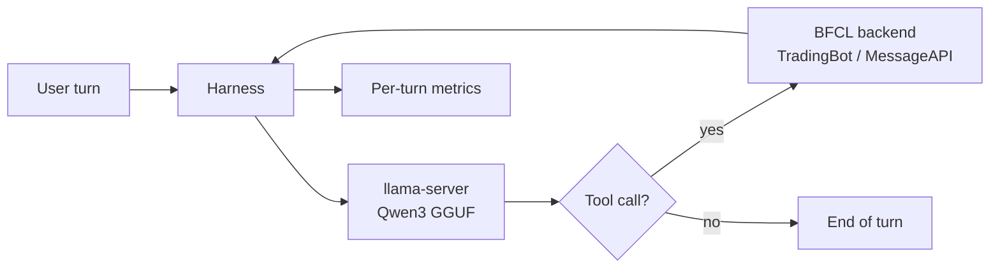
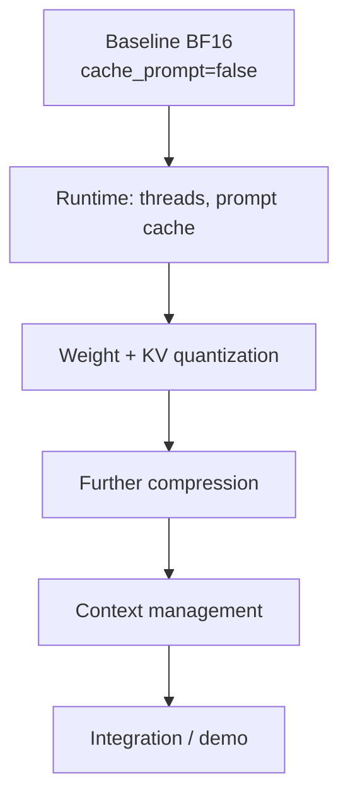
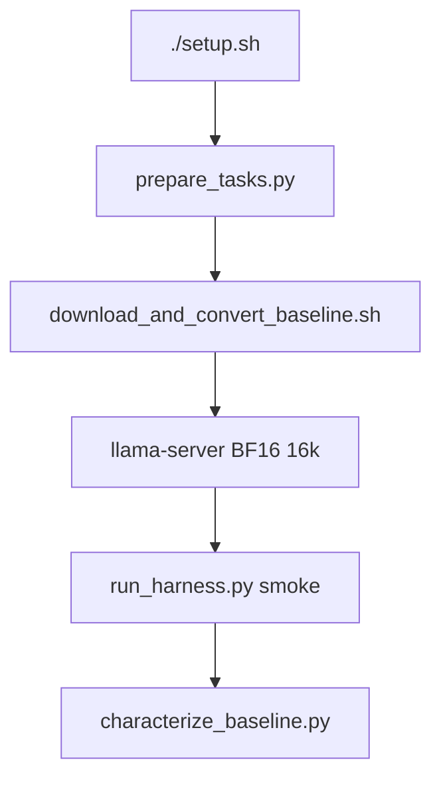

# Long Context Tool-Calling Agent

AI624 · AI on Edge Devices · Fall 2026  
**Track A — Project A1** · 8 GB Raspberry Pi 5

On-device multi-turn tool calling with Qwen3 through [llama.cpp](https://github.com/ggml-org/llama.cpp) `llama-server`. Sessions grow to tens of thousands of tokens as tool outputs are appended; the agent must still emit a valid call at the end.

## Table of contents

1. [Overview](#1-overview)
2. [System diagram](#2-system-diagram)
3. [Milestones and progress](#3-milestones-and-progress)
4. [Tool subset and tasks](#4-tool-subset-and-tasks)
5. [Requirements](#5-requirements)
6. [Setup](#6-setup)
7. [Week 1 workflow (host)](#7-week-1-workflow-host)
8. [Measurement notes](#8-measurement-notes)
9. [Repository layout](#9-repository-layout)

---

## 1. Overview

| | |
|---|---|
| **Runtime** | `llama.cpp` / `llama-server` (every token on device) |
| **Model family** | Qwen3, full attention in every layer (Qwen3.5 hybrids are out of scope) |
| **Baseline** | Qwen3-1.7B BF16, 16k context, `cache_prompt: false` |
| **Tools** | ~20–30 BFCL multi-turn functions, long-context mode, must include TradingBot |
| **Out of scope** | Multi-agent orchestration; model served from another machine |

Latency, memory, and power are measured on the Pi. Task accuracy may be scored on a host with the same weights and pipeline. Until the board arrives, develop on this Linux host and rebuild on the Pi before reporting device metrics.

### Baseline rules (before any optimization)

- Qwen3-1.7B (or the 2–4B member of the family) in BF16
- 16k context (fits in 8 GB)
- Stateless client: full history resent every turn, prefix caching **off**
- All tool schemas in the system prompt
- Unconstrained sampling, default llama.cpp build settings

`llama-server` caches prompt prefixes by default. The baseline client must send `cache_prompt: false`.

---

## 2. System diagram

Each user turn: the model emits a tool call → the tool runs locally via BFCL backends → the result is appended to the chat context → the model continues.



Improvement lineage (kept / discarded steps, same held-out split):



---

## 3. Milestones and progress

Each change is applied on top of the last accepted configuration. Every step is measured on the same held-out split and marked **kept** or **discarded**. Discarded steps stay in the lineage.

| When | Due | Status | Deliverable |
|---|---|---|---|
| Week 1 presentation | 29 Nov 2026 | In progress (host) | Tool subset, trace set, harness; baseline characterized on the Pi |
| Week 2 presentation | 6 Dec 2026 | Not started | Prompt caching; weight and KV-cache quantization |
| Final presentation, demo, viva | 20 Dec 2026 | Not started | Further compression, context management, live demo |
| Code and report | 24 Dec 2026 | Not started | Documented code and written report |

### 3.1 Week 1 checklist

Legend: `[x]` done on this Linux host · `[ ]` still open · `[P]` must be redone or measured on the Pi

#### Infrastructure

- [x] Repo layout, `setup.sh`, lean `.venv`, `.venv-convert`
- [x] Submodules: `third_party/llama.cpp`, `third_party/gorilla`
- [x] Native `llama-server` / `llama-cli` / `llama-quantize` / `llama-imatrix` build (x86 host)
- [ ] `[P]` Rebuild llama.cpp on the Pi (`./setup.sh` there)
- [x] Download `Qwen/Qwen3-1.7B` HF weights (`models/hf/Qwen3-1.7B/`)
- [x] Convert to `models/qwen3-1.7b-bf16.gguf`
- [x] Serve BF16 at 16k on the host (`llama-server` on `127.0.0.1:8080`)

#### Task 1 — tool subset and long session

- [x] Fixed subset: TradingBot (20) + MessageAPI (10) = 30 tools
- [x] BFCL long-context tasks for that subset (33 tasks)
- [x] Train / test hold-out
- [x] Five project long tasks (16k–32k target)
- [x] At least two early-detail long tasks held out in the test split

#### Task 2 — client harness

- [x] `src/a1_agent` harness (client, BFCL backends, parse/validate)
- [x] Per-turn token and timing logs, call validity
- [x] `cache_prompt: false` and schemas in the system prompt
- [ ] End-to-end harness smoke against the live `llama-server`

#### Task 3 — baseline characterization

- [ ] Host harness smoke + session success / call-validity logs on a long task
- [ ] Host prefill/decode sweep at ≥3 context lengths (`scripts/characterize_baseline.py`)
- [ ] `[P]` Peak memory, bandwidth-bound decode check, power/thermal on the Pi
- [ ] `[P]` Full held-out test split on the Pi before any optimization

---

## 4. Tool subset and tasks

Configured in [`configs/tool_subset.json`](configs/tool_subset.json).

| Backend | Tools | Role |
|---|---|---|
| TradingBot | 20 | Required. Verbose order/transaction dumps grow sessions past 16k tokens. |
| MessageAPI | 10 | Second BFCL backend; brings the set to 30 tools. |

**BFCL source:** `BFCL_v4_multi_turn_long_context.json`, keeping tasks where  
`involved_classes ⊆ {TradingBot, MessageAPI}` and TradingBot is present.

**Extras:** five project tasks in `data/tasks/long_extra.jsonl`. At least two need a detail planted early in the session.

| Split | Path |
|---|---|
| Train | `data/tasks/train.jsonl` |
| Test (held out) | `data/tasks/test.jsonl` |
| Long extras only | `data/tasks/long_extra.jsonl` |
| Summary | `data/tasks/split_summary.json` |

Regenerate with:

```bash
source .venv/bin/activate
python scripts/prepare_tasks.py
```

---

## 5. Requirements

### 5.1 Hardware

- **Reported metrics:** 8 GB Raspberry Pi 5
- **Development:** any Linux host (rebuild on the Pi; x86 binaries will not run there)

### 5.2 System packages

Debian / Ubuntu / Raspberry Pi OS:

```bash
sudo apt-get update
sudo apt-get install -y build-essential cmake git pkg-config \
  libcurl4-openssl-dev python3-venv python3-dev
```

### 5.3 Python

- Python 3.10+
- `.venv` — lean harness deps (`requests`, `PyYAML`) + BFCL via submodule path
- `.venv-convert` — GGUF converter (`numpy~=2.2.6`, `torch==2.11.0` CPU)

### 5.4 Submodules (shallow)

| Path | Repository | Role |
|---|---|---|
| `third_party/llama.cpp` | [ggml-org/llama.cpp](https://github.com/ggml-org/llama.cpp) | Server, quantize, imatrix, HF→GGUF |
| `third_party/gorilla` | [ShishirPatil/gorilla](https://github.com/ShishirPatil/gorilla) | BFCL (`berkeley-function-call-leaderboard` only) |

### 5.5 Weights

Not in git. Convert locally from [Qwen/Qwen3-1.7B](https://huggingface.co/Qwen/Qwen3-1.7B).  
The official GGUF repo ships Q8_0 only — that is **not** the baseline.

---

## 6. Setup

### 6.1 Clone

```bash
git clone --recurse-submodules --shallow-submodules \
  git@github.com:WajahatRiaz/g7a1-ai-edge-devices-project.git
cd g7a1-ai-edge-devices-project
```

If submodules are missing:

```bash
git submodule update --init --depth 1
```

### 6.2 Build toolchains and llama.cpp

```bash
./setup.sh
source .venv/bin/activate
```

What `./setup.sh` does by default:

1. Init submodules if needed  
2. Create `.venv` and install lean harness deps  
3. Create `.venv-convert` for GGUF conversion  
4. Build `llama-server`, `llama-cli`, `llama-quantize`, `llama-imatrix`

### 6.3 Optional: download and convert the model

Weights are opt-in (several GB):

```bash
DOWNLOAD_MODEL=1 ./setup.sh
# or, after a normal setup:
./scripts/download_and_convert_baseline.sh
```

---

## 7. Week 1 workflow (host)



### 7.1 Download and convert BF16 GGUF

Preferred (resume-safe): `huggingface_hub` for small files, then `curl -C -` for the ~3.3 GB `model-00001` shard, then convert.

```bash
./scripts/download_and_convert_baseline.sh
```

Manual equivalent:

```bash
mkdir -p models/hf/Qwen3-1.7B

.venv-convert/bin/python - <<'PY'
from huggingface_hub import snapshot_download
snapshot_download("Qwen/Qwen3-1.7B", local_dir="models/hf/Qwen3-1.7B")
PY

curl -L --retry 50 --retry-all-errors --retry-delay 3 \
  -C - \
  -o models/hf/Qwen3-1.7B/model-00001-of-00002.safetensors \
  "https://huggingface.co/Qwen/Qwen3-1.7B/resolve/main/model-00001-of-00002.safetensors"

.venv-convert/bin/python third_party/llama.cpp/convert_hf_to_gguf.py \
  models/hf/Qwen3-1.7B \
  --outfile models/qwen3-1.7b-bf16.gguf \
  --outtype bf16
```

Optional: `export HF_TOKEN=...` for higher Hugging Face rate limits.

### 7.2 Serve the baseline

**Host memory warning:** BF16 (~3.8G weights) + a large KV cache can thrash swap and lock up a ~16GB machine. On this host use **one** server at `-c 8192` (or `16384` max). Do **not** start a second server on `:8081` with `-c 32768`, and do **not** pass `--long-context` until you have headroom (or are on the Pi).

```bash
# confirm nothing else is holding the GGUF
pkill -f llama-server || true

./build/llama.cpp/bin/llama-server \
  -m models/qwen3-1.7b-bf16.gguf \
  -c 8192 \
  --jinja \
  -t 4 \
  --host 127.0.0.1 \
  --port 8080
```

### 7.3 Host baseline validation (run in series)

Keep that **single** `llama-server` running. In a second shell, run these **one after another**. Only continue if the previous step finishes cleanly. Harness defaults to **no** BFCL long dumps (`--long-context` is opt-in).

Baseline config: `cache_prompt: false`, schemas in the system prompt ([`configs/baseline.yaml`](configs/baseline.yaml)).

```bash
source .venv/bin/activate

# 1) smoke one TradingBot task  (Task 2 — harness + tools; no long dumps)
python scripts/run_harness.py --split long_extra --task-id long_extra_03_fund_after_dump

# 2) small held-out sample  (Task 1/3 — held-out split sanity check)
python scripts/run_harness.py --split test --limit 3

# 3) host prefill/decode sweep  (Task 3 — keep lengths under server -c)
python scripts/characterize_baseline.py --lengths 512,2048,4096
```

| Step | What it checks | Milestone |
|---|---|---|
| 1 | Server + harness + tools on a TradingBot task (short dumps) | Week 1 Task 2 |
| 2 | Same pipeline on a few held-out test tasks | Week 1 Tasks 1 & 3 |
| 3 | Prefill/decode at 512 / 2048 / 4096 tokens | Week 1 Task 3 (host timings) |

Full BFCL long-context dumps (`--long-context`) and larger `-c` belong on the Pi (or a host with free RAM and no swap thrash). Logs land under `results/baseline/`. Memory, energy, and thermal fields stay null until the Pi.

### 7.4 Quantize only after the baseline is characterized

```bash
./build/llama.cpp/bin/llama-quantize \
  models/qwen3-1.7b-bf16.gguf \
  models/qwen3-1.7b-q4_k_m.gguf \
  Q4_K_M
```

---

## 8. Measurement notes

**Every change reports:** session success, call validity, per-turn latency (prefill / decode / tool), cold and warm time to first call, peak memory, energy per session, thermal state.

**On the Pi**, from a separate process:

```bash
vcgencmd pmic_read_adc    # sum V×I over rails; integrate over steady window
vcgencmd measure_temp
vcgencmd get_throttled    # flag throttled runs
```

**Record with every result:**

```bash
git -C third_party/llama.cpp rev-parse HEAD
```

Also record build flags and GGUF formats.

---

## 9. Repository layout

```text
setup.sh                              # submodules, venvs, llama.cpp build
requirements.txt                      # lean harness deps
configs/
  tool_subset.json                    # TradingBot + MessageAPI (30 tools)
  baseline.yaml                       # BF16, 16k, cache_prompt=false
src/a1_agent/                         # client, parser, backends, harness
scripts/
  prepare_tasks.py                    # BFCL subset + long extras + split
  run_harness.py                      # multi-turn loop vs llama-server
  characterize_baseline.py            # prefill/decode sweep
  download_and_convert_baseline.sh    # HF + curl resume + BF16 GGUF
data/tasks/                           # train / test / long_extra
third_party/llama.cpp                 # inference runtime (submodule)
third_party/gorilla/…                 # BFCL backends (submodule)
build/llama.cpp/bin/                  # llama-server and tools (local)
models/                               # HF weights + GGUF (gitignored)
results/                              # per-run metrics (gitignored)
docs/                                 # course project description
```

Gitignored: `.venv/`, `.venv-convert/`, `build/`, `models/`, `results/`, `logs/`.
