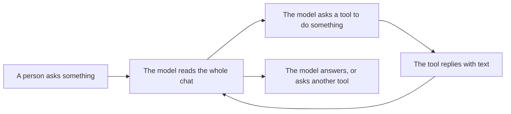
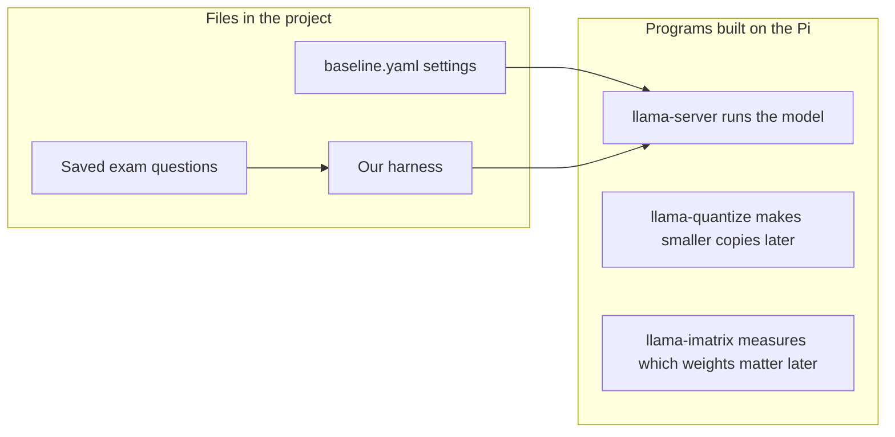
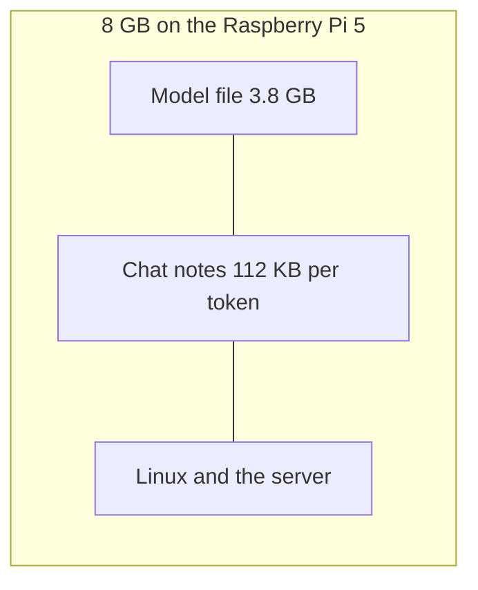
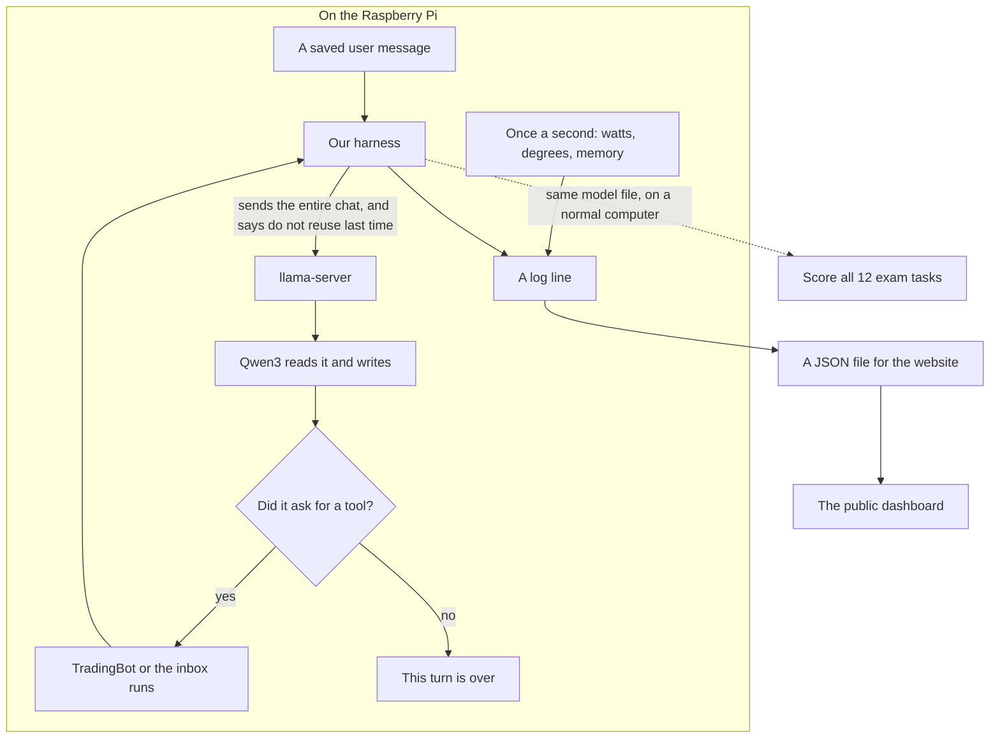
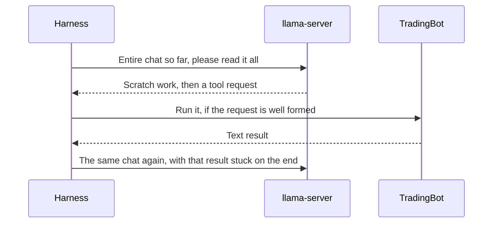
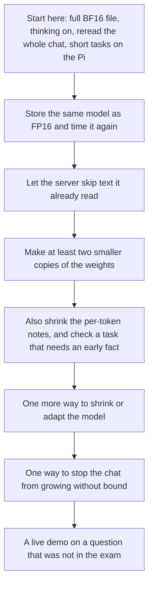

# Long Context Tool-Calling Agent

AI624 · AI on Edge Devices · Fall 2026  
Track A — Project A1 · 8 GB Raspberry Pi 5

Wajahat Riaz  
26 Nov 2026

Live charts: [wajahatriaz.github.io/g7a1-ai-edge-devices-project](https://wajahatriaz.github.io/g7a1-ai-edge-devices-project/)  
How to run it: [README.md](../README.md)  
Course handout: [Project_Description_AI624_2026.pdf](Project_Description_AI624_2026.pdf)

This is the talk, written for someone who has not seen the project. Each section says what a thing is, then what this project does with it. Numbers from 26 Nov 2026 are from a run that had not finished. They are observations, not the final score.

---

## 1. The project in one page

A **language model** is a program that continues text. You give it a conversation. It predicts the next piece of text, then the next, until it stops.

An **agent** is that model plus a rule: when the text is a request to use a program, actually run the program, paste the result back into the conversation, and let the model continue. The programs are called **tools**. In this project the tools are a pretend stock-trading account and a pretend inbox.

The whole agent has to run on one small computer, a **Raspberry Pi 5** with 8 GB of memory. Nothing is sent to a bigger computer to do the thinking. The course forbids that.

The hard part is length. Every tool reply is pasted onto the conversation. The next question sends the entire conversation again. A short chat becomes a very long document, and the small computer has to read all of it, every time, and still produce a correct tool request at the end.



Two jobs are measured separately:

- **Speed, memory, heat, and power** are measured on the Pi. That is the point of the course.
- **Did it get the tasks right?** The full exam can be scored on a normal computer, using the same model file and the same programs. Timing that exam on the Pi would take many hours.

---

## 2. Words used in this talk

Read this once. Later sections use the short name and remind you what it means.

**Raspberry Pi 5.** A small single-board computer, about the size of a deck of cards. This one is the 8 GB model: 8 gigabytes of RAM, which is the working memory programs use while they run. A laptop often has 16 GB or more. The processor has 4 cores. The machine in this project is that board. Its name on the network is `g7a1-machine`.

**Token.** The model does not read letters one by one, and it does not read whole sentences as one unit. Text is cut into tokens. A common word may be one token. In this model, each digit is its own token, so the number `2203.40` is many tokens. "10k tokens" means about ten thousand of these pieces. Time is often quoted in **tokens per second** (tok/s): how many pieces the computer gets through in one second.

**Prompt.** The text we send in. For a chat, the prompt is the instructions plus the whole conversation so far.

**Context.** How much of that conversation the model is allowed to hold at once. A context of 8,192 tokens means the prompt plus the model's new text must fit in 8,192 tokens. Longer than that, and the server cannot accept the turn.

**Weights.** The learned numbers inside the model. They are the model. Qwen3-1.7B has about 1.7 billion of them. The file on disk is about 3.8 GB when each number is stored in a format called BF16.

**BF16 and FP16.** Two ways to store those numbers with 16 bits each. BF16 (bfloat16) is what the starting file uses. FP16 (float16) is the same size on disk but uses a layout this Pi can multiply faster. Changing BF16 to FP16 is the first speed experiment. It is not the starting point. The course wants the slow, full-precision-style file measured first, so later speedups have something to beat.

**GGUF.** The file format llama.cpp uses for a model. `models/qwen3-1.7b-bf16.gguf` is Qwen3 stored that way. A smaller GGUF, such as Q8 or Q4, stores the same model with fewer bits per number. That is **quantization**: a smaller, faster, slightly less exact copy. We have not made those copies yet.

**Qwen3-1.7B.** The model, made by Alibaba's Qwen team. "1.7B" is the size. It is a **dense** model: every layer runs for every token. Some newer models skip layers or use a sliding window so long chats stay cheap. This one does not. That is why the course picked it. The full model can handle 32,768 tokens. This Pi is serving 8,192, because the memory for a longer chat does not fit comfortably.

**llama.cpp.** A program that runs models like Qwen on ordinary CPUs, without a large NVIDIA GPU. The copy in this project is commit `d1eb0de`.

**llama-server.** The part of llama.cpp that sits in the background and answers HTTP requests. The harness talks to `http://127.0.0.1:8080/`. A browser can also open that address and chat. `127.0.0.1` means "this machine only." The model is not exposed on the public internet.

**Prefill.** The model reading the prompt it was just given. On a long prompt this is most of the wait. We measured this part at about half a token per second while the Pi was hot.

**Decode.** The model writing new tokens, one by one. That includes its private reasoning and the tool request.

**KV cache.** While the model reads, it stores notes for every token so it does not recompute them from scratch inside one request. Those notes are the KV cache ("keys and values" from the attention math). They grow with every token and live in RAM. For this model the course handout puts them at about 112 KB per token. At 8,192 tokens that is about 0.9 GB. At 32,768 tokens it is about 3.5 GB, which plus the 3.8 GB weight file does not fit in 8 GB once the operating system is running.

**Attention.** The step where each token looks at the others. **Flash attention** is a faster way to do that step. The server flag is `--flash-attn auto`, which means "turn it on when this model supports it." We left that default alone.

**Tool, schema, tool call.** A tool is a function the model may ask to run, such as "add MSFT to the watchlist." A **schema** is the written description of that function: its name, its arguments, and what it returns. All 30 descriptions are pasted into the instructions so the model can see them. A **tool call** is the model naming one function and filling in the arguments. The harness checks that the name exists and the required arguments are present, then runs it.

**BFCL.** The Berkeley Function Calling Leaderboard. It is a public exam for "can a model use tools?" It includes fake apps with real code, so a call can be executed and the resulting account state can be checked. We use that code. We do not submit scores to their website.

**TradingBot and MessageAPI.** Two of those fake apps. TradingBot is a stock account: login, balance, orders, watchlist, stock quotes, transaction history. It has 20 tools. MessageAPI is an inbox. It has 10 tools. The course requires TradingBot. MessageAPI is there so the set has 30 tools, which is the top of the allowed range (20 to 30).

**Turn.** One user message, plus everything the model and the tools do before the next user message. Inside one turn the model may call several tools.

**Session.** The whole task, several turns long.

**Harness.** Our Python program (`src/a1_agent`) that plays the user from a saved task, sends the chat to llama-server, runs the tools, and writes down the timings.

**Stateless client / prefix cache off.** A prefix is the start of the prompt that is identical to last time. llama-server will reuse that work unless we say no. The starting experiment says no: `cache_prompt: false`. Every turn, the full conversation is sent and read again. That is deliberately wasteful. It is the "before" picture. Turning the cache on is a later experiment.

**Thinking mode.** Qwen3 can write a private scratchpad, marked as thinking, before it answers. The course note found that with thinking switched off, the model said it would add money to an account and then stopped without calling `fund_account`. With thinking on, it called `fund_account(amount=2203.4)`. The starting setup leaves thinking on. That is also Qwen's default.

**Sampling.** When several next tokens are plausible, sampling picks one. **Temperature** 0.6 means "not completely rigid, not wild." **top-p** 0.95 and **top-k** 20 limit which candidates are eligible. These three numbers are Qwen's recommendation for thinking mode. Temperature 0 would always pick the single most likely token. The course note asked us not to use that for the baseline.

**System prompt.** The standing instructions at the top of every chat, including the 30 tool descriptions. The model sees them on every turn because the whole chat is resent.

**Train split and test split.** The tasks are divided so the ones we might later learn from (26 tasks) are not the ones we report as the exam (12 tasks). The exam tasks are **held out**: they stay unseen for scoring.

**Early detail.** A fact that appears near the start of a long chat, which a later question asks for. If the model only looks at the end, it fails. Two exam tasks are built this way.

**Host.** Any normal computer that is not this Pi. It is only for scoring the 12 exam tasks with the same model file. The Pi remains the place where speed and power are measured.

**Baseline.** The starting configuration, before any speedup. If we change the file format or turn caching on first, we have nothing honest to compare against.

**Throttling.** The Pi protects itself when it gets too hot. It lowers the processor speed. The chip can sit near 95°C and do less work per second while drawing only a few watts. A run in that state is a hot run, and the speed is not the speed of a cool board.

---

## 3. The computer and the software

| Thing | Plain meaning | What we use |
|---|---|---|
| Board | The computer under test | Raspberry Pi 5 Model B Rev 1.0, 8 GB RAM, 4 cores |
| Operating system | Raspberry Pi OS, Linux | Kernel `6.18.60+rpt-rpi-2712` |
| Model runner | The program that loads Qwen and answers requests | llama.cpp, built on this Pi, commit `d1eb0de` |
| Server process | That runner, waiting for chat requests | `llama-server` on port 8080, one chat at a time |
| Model file | The 1.7B weights | `models/qwen3-1.7b-bf16.gguf`, about 3.8 GB, BF16 |
| Context window | How long a chat may be | 8,192 tokens (`-c 8192`) |
| Parallel slots | How many chats the server prepares memory for | 1 (`-np 1`). The default of 4 would reserve four copies of the KV cache and slow this model down |
| Threads | How many cores read the prompt, and how many write tokens | 4 to read a batch (`-tb 4`), 2 to write (`-t 2`) |
| Tool code | The fake trading account and inbox | BFCL, folder `third_party/gorilla` |
| Our glue | Sends chats, runs tools, writes logs | `src/a1_agent` and the scripts in `scripts/` |
| Python environment | A private set of Python libraries | `.venv` for the harness. `.venv-convert` only for turning the downloaded model into GGUF |
| Power meter | Reads the board's own power chips | `vcgencmd pmic_read_adc` |
| Thermometer | Reads the chip temperature and whether it has slowed itself | `vcgencmd measure_temp`, `vcgencmd get_throttled` |
| Dashboard | A web page of past runs | `docs/index.html`, published on GitHub Pages |



`llama-quantize` and `llama-imatrix` are already compiled. They are for later, when we make smaller copies of the model. The starting measurement uses the full BF16 file only.

The server command, written out, is:

```bash
llama-server \
  -m models/qwen3-1.7b-bf16.gguf \
  -c 8192 --jinja --webui \
  -t 2 -tb 4 -np 1 \
  --host 127.0.0.1 --port 8080
```

`--jinja` tells the server to use Qwen's official chat template, including thinking. `--webui` turns on the browser chat at `http://127.0.0.1:8080/`. That page is how a live demo will work later. The demo has to be a task that was not used for scoring.

---

## 4. Why 8 GB runs out

The model file is about 3.8 GB and stays in memory the whole time. On top of that, the KV cache adds about 112 KB for every token the current chat has read.

| What is in memory | Size |
|---|---|
| The BF16 weight file | about 3.8 GB |
| Notes kept per token (KV cache) | about 112 KB each |
| An 8,192-token chat | about 0.9 GB of notes |
| A 16,384-token chat | about 1.75 GB of notes |
| A 32,768-token chat | about 3.5 GB of notes |

The course handout's "official" starting context is 16,384 tokens. That fits, with the weights, in 8 GB. A 32,768-token chat plus the weights does not, once Linux is using memory too. The server that is actually running was started at 8,192 tokens. Raising it is possible later. It is not what this measurement is using.

The 112 KB figure comes from the shape of Qwen3-1.7B: 28 layers, 8 key/value heads, 128 numbers wide, two bytes each, and both a key and a value. 2 × 28 × 8 × 128 × 2 bytes = 114,688 bytes, which is 112 KiB.



---

## 5. What the course asks for, in order

The handout wants a before-and-after story. First measure the plain setup. Then change one thing, measure again on the same exam, and keep the change only if it helps.

| When | Due | What "done" means, in plain words |
|---|---|---|
| Week 1 | 29 Nov 2026 | The tools, the questions, the harness, and a measured starting run on the Pi |
| Week 2 | 6 Dec 2026 | Reuse work the model already did, and try smaller copies of the weights |
| Final talk and demo | 20 Dec 2026 | One more way to shrink the model, one way to handle long chats, and a live demo |
| Written report | 24 Dec 2026 | The code and a report that matches the numbers |

What Week 1 includes:

- **The questions.** 20 to 30 tools, TradingBot included, chats that get long, at least five tasks meant to reach 16k–32k tokens, at least two where the answer depends on something said early, and an exam set we do not tune on.
- **The harness.** For every turn, write down how many tokens were sent, how many were read again, how long reading took, how long writing took, how long the tool took, and whether the tool call was well formed.
- **The characterization.** Time reading and writing at three or more lengths. Say how much memory was used. Check whether writing speed is limited by memory bandwidth. Report the clock time of a turn and of a whole session.

What every later change must still report: did the session succeed, were the calls valid, the time split into reading / writing / tool, how long until the first call on a cold start and on a warm start, peak memory, energy for the session, and whether the chip got hot enough to slow down.

---

## 6. How one question moves through the system



Step by step:

1. The harness builds the message. At the top are the standing instructions and all 30 tool descriptions. Under that is every earlier user message, model reply, and tool result.
2. It sends that to llama-server with `cache_prompt: false`, so the server reads it from the first token.
3. The model first writes its thinking, then either a tool call or a normal reply. It may write up to 2,048 new tokens (`max_tokens`). An earlier cap of 512 was small enough that thinking could use the whole budget and the tool call never appeared.
4. If there is a tool call, the harness checks the name and the required arguments, runs the fake app, and appends the app's reply.
5. The next request includes that reply. The old text is sent again.

The dotted arrow is the accuracy run. It uses the same weights and the same harness. It does not have to be timed on the Pi. The command is `./scripts/run_host_accuracy.sh`.

---

## 7. The questions and the two fake apps

The list of tools is `configs/tool_subset.json`.

| Fake app | How many actions | What a person would recognize |
|---|---|---|
| TradingBot | 20 | Look up a stock, see the balance, place or cancel an order, edit a watchlist, read past deposits and withdrawals |
| MessageAPI | 10 | List messages, send one, delete one, similar inbox actions |

The questions come from BFCL's long-chat set, file `BFCL_v4_multi_turn_long_context.json`. A question is kept only when every app it needs is one of those two, and it does use TradingBot. `scripts/prepare_tasks.py` copies them into three files.

| Pile | How many | File | What it is for |
|---|---|---|---|
| Questions kept from BFCL | 33 | | The raw pool |
| Practice | 26 | `data/tasks/train.jsonl` | May be used later to build a smaller model. Not the reported exam |
| Exam | 12 | `data/tasks/test.jsonl` | Scored, and not used to tune |
| Extra long tasks we wrote | 5 | `data/tasks/long_extra.jsonl` | Meant to push length. Two of them are inside the exam because they hide an early fact |

The timed run on the Pi uses one short extra task, `long_extra_04_watchlist`. The user speaks twice. First: look up the transaction history, look at the watchlist, and add the symbol MSFT. Second: look at the watchlist again and confirm MSFT is there. MSFT is the ticker for Microsoft. The task is short on purpose. A longer trading task, `long_extra_03_fund_after_dump`, previously made the Pi read about 36,000 tokens. At about 1.4 tokens per second that is about 7 hours. The course note said to treat anything well above about 10,000 tokens as too long for this starting setup, and to leave those chats for the later speedups.

### Why some tool replies are enormous

Long-context mode in TradingBot pads some replies with made-up extra records. The real answer is at the front. The padding is not saved into the account. It exists so the chat gets long.

Because this model spends a whole token on each digit, a page of fake prices and timestamps becomes a huge prompt. A course note measured the uncapped tools:

| Reply | Before we cut the padding | After the cut |
|---|---|---|
| One stock quote, `get_stock_info` | about 31,600 tokens | about 7,900 tokens |
| Transaction history | about 49,300 tokens | about 4,900 tokens |
| A typical TradingBot chat, counting tool text only | middle of the pack 32,000–36,000 tokens, longest about 67,000 | middle 8,000–11,000, longest about 18,000 |

The other fake apps in that note stayed near 3,000 tokens. The "~11,000 tokens" in the course handout matches the cut version, not the raw padding.

`setup.sh` adds four lines to the end of `long_context.py` if they are not already there:

```python
MA_5_EXTENSION = MA_5_EXTENSION[:500]
MA_20_EXTENSION = MA_20_EXTENSION[:500]
WATCH_LIST_EXTENSION = WATCH_LIST_EXTENSION[:500]
TRANSACTION_HISTORY_EXTENSION = TRANSACTION_HISTORY_EXTENSION[:100]
```

In ordinary language: keep the first 500 padded moving-average points, the first 500 padded watchlist entries, and the first 100 padded transactions. Drop the rest.

That file is the one both sides import. The harness runs the tools from it. BFCL's checker, the program that decides whether the final account looks right, imports the same file on this machine. If only one copy were cut, a run could do the right thing and still be marked wrong, because the checker would be simulating a different, longer tool. There is no second copy under the Python environment. Both `import bfcl_eval` and the harness point at `third_party/gorilla/.../long_context.py`.

The course note replayed the official answers for all 50 TradingBot long-context tasks with and without the cut. The final accounts matched, and no official call started failing. Our own check: after the cut, `get_stock_info("AAPL")` returned 7,983 characters of compact JSON, in the same range as "about 7,900 tokens" once digits are split apart.

The timed watchlist task is started without the long-padding switch. The cut still matters as soon as we turn that switch on.

---

## 8. The starting settings, one by one

These live in `configs/baseline.yaml`. Later experiments change one row and say whether the change was kept.

| Setting | Value | What it means if you have not seen it |
|---|---|---|
| Weights | the BF16 GGUF | The full starting file. A faster 16-bit layout is the first experiment, and it does not replace this file |
| Context | 8,192 tokens | How long a single chat may grow on the running server |
| Reuse earlier reading | off | Every turn is read from the first word again |
| Tool descriptions | all 30, in the instructions, and also sent as a tool list | The model can see them, and the server can return a structured call |
| Thinking | on | The model may write scratch work before the call. Turning it off made it skip a required call |
| How the next word is chosen | temperature 0.6, top-p 0.95, top-k 20 | Qwen's published recipe for thinking mode. The non-thinking recipe, if we compare later, is 0.7, 0.8, and 20 |
| Longest reply | 2,048 new tokens | Enough room for scratch work and the call |
| Forced output format | off | We do not make the server reject text that fails a grammar. The baseline is "let the model speak" |
| Cores | 2 for writing, 4 for reading, 1 chat slot | Matches the 4-core board without reserving four copies of the cache |



The Pi script that measures this starting point is `./scripts/run_baseline.sh`. It does two things, aimed at about 10,000 tokens of work altogether:

1. The short watchlist task above.
2. A speed sweep: feed the model a dummy prompt of 512 tokens, then 2,048, then 4,096, and let it write 32 tokens each time. That separates "how long does reading take?" from the complications of a real tool chat.

A wrapper, `./scripts/sample_device.sh`, starts the power and temperature log before each of those and stops it when the command exits. `./scripts/export_dashboard.sh` copies the summary into the file the website reads.

---

## 9. What gets written down

| What | Everyday meaning | Where it comes from |
|---|---|---|
| Prompt tokens | How long the chat was when we sent it | The server's own timing line |
| Cached tokens | How much of that the server skipped because it matched last time | Same line. In the baseline this should stay at zero, because we asked it not to skip |
| Generated tokens | How much the model wrote, including thinking | Same line |
| Prefill time | How long the reading took | Harness, per turn |
| Decode time | How long the writing took | Harness, per turn |
| Tool time | How long the fake app took. These apps are instant compared with the model | Harness |
| Wall time | Reading plus writing plus the tool, as a clock would see it | Harness |
| Call validity | The function exists, and the required arguments were filled in | Our checker |
| Session success | The account ended in the state the task asked for. Examples: the balance equals a number, the watchlist contains a symbol, an early fact was recalled | Per-task checks |
| Power | Watts, from voltage times current on each supply rail that reports both | About one sample a second. Energy in joules is the area under that curve |
| Temperature | Degrees Celsius of the main chip | `measure_temp` |
| Throttle | Whether the chip has cut its speed | `get_throttled` |
| Peak memory | The most RAM the server process itself used | High-water mark of that process, not "how full is the 8 GB" |
| Bandwidth check | A back-of-the-envelope: if each new token must reread the whole weight file, does the measured writing speed match the board's memory speed? | Computed after a sweep exists. Not computed yet |

Rails named `EXT5V` and `BATT` report a voltage and no current. They are left out of the watt sum. Inventing an input power from voltage alone would be a guess.

The throttle word is a bit field. The low half says what is true right now: undervoltage, frequency capped, throttled, soft temperature limit. The high half says what has happened at any time since boot. `0x80000` means "the soft temperature limit happened earlier." By itself that does not throw the run away. During the 26 Nov run the value was `0xe0006`, which means the frequency is capped and the CPU is throttled right now, and those events are also in the since-boot history.

The website keeps one card per run, named by date and time. The next run of the same kind is drawn against the previous one. A shorter reading time is better. A higher tokens-per-second number is better.

---

## 10. What the 26 Nov run had shown when this was written

`./scripts/run_baseline.sh` started at 11:39 in the morning, Pakistan time, on 26 Nov 2026. The log folder is `results/baseline/history/2026-11-26T06-39-36Z` (`06:39` UTC is `11:39` PKT). At the time of writing, the watchlist task was still on its first reading. No score file existed yet. The 512 / 2,048 / 4,096 sweep had not started.

The server had finished 2,048 tokens of that first prompt and reported progress 0.37, so the prompt is about 5,500 tokens. Most of that is the 30 tool descriptions, not the user's two sentences.

| What we saw | Value | How to read it |
|---|---|---|
| Reading speed | 2,048 tokens in 3,839 seconds, which is **0.53 token per second** | About two seconds per token. A 5,500-token read is on the order of three hours by itself |
| Chip temperature | 93–95°C | Hot enough that the board is protecting itself |
| Speed limit | frequency capped and throttled, right now | The 0.53 figure is a hot-board figure |
| Power while hot | about 2.9–3.8 W | A few watts. The chip is not doing more work by drawing more power; it has slowed down |
| At the start of the run | 74.7°C, not actively throttled, about 3.6 W | It heated up during the first read |

An earlier, abandoned attempt on the long funding task moved about 36,000 tokens at about 1.4 tokens per second. 0.53 is slower than that. The difference lines up with this board sitting at 95°C. The course note also expects BF16 itself to be slower than FP16 on a Pi, because the chip has faster instructions for FP16. We have not converted the file, so this run does not test that idea. It only shows the starting file, on a hot board.

If the model asks for the three watchlist actions in one reply, the script can finish the same evening. If it asks for them one at a time, each reply causes another full read of a growing chat, and the script runs into the next morning. Either way, this is the "before" number the later experiments have to beat.

---

## 11. What we will try afterwards

None of these have been run. The order follows the handout. FP16 is first because the course note pointed at it as the likely reason the starting speed is low.



What each box means:

- **FP16.** Same model, different 16-bit packing, which this CPU multiplies faster. The BF16 file stays in the repo as the starting point.
- **Prompt cache.** Tell the server it may reuse the reading it did for the unchanged start of the chat. Only the new tool result and the new question should be read. The chat template must stay the one used at the start, or the comparison is unfair.
- **Smaller weight files.** At least two GGUF quantizations. An **importance matrix** (`llama-imatrix`) is a table of which weights the model uses most on our own chats. Quantizing with that table should damage the model less than quantizing with a generic text sample. We report both.
- **Smaller KV cache.** The per-token notes can be stored with fewer bits too. Q4 and Q8 are the obvious first tries. The course wants something beyond those, checked on a task that fails if an early detail was forgotten. Shrinking the notes is a likely way to forget them.
- **Thinking versus not thinking, at each size.** Smaller weights are expected to damage the scratchpad more than they damage a short tool call. If "thinking off" survives quantization better, that can be a step, and the talk has to show how much accuracy it gave up relative to this thinking-on start.
- **One further compression.** The handout allows pruning (deleting parts of the network), distillation (training a smaller model to imitate this one), LoRA (a small add-on trained for tool use), or outlier suppression (special handling for a few unusually large weights). A paper that trains those add-ons for Qwen3-1.7B and Qwen3-4B is listed in the references. If we do that, the training chats should include thinking, because thinking is the mode we are trying to keep.
- **Context management.** Some policy for long chats: summarize old turns, drop old tool output, or keep only the early fact the later question needs. One such policy is required.
- **Demo.** A person types into the web page or the terminal, on a question that was not in the 12-task exam or the practice set.

Flash attention stays on its default unless a measurement shows the server actually turned it off.

---

## 12. Checklist

### Already in place

- [x] llama.cpp built on this Pi, including the server, a one-shot chat tool, the quantizer, and the importance-matrix tool
- [x] Qwen3-1.7B downloaded and saved as a BF16 GGUF, and the server is running that file
- [x] 30 tools, 26 practice tasks, 12 exam tasks, 5 extra long tasks, 2 of them held out because they depend on an early fact
- [x] Harness that checks calls, refuses prefix reuse, and puts every tool description in the instructions
- [x] Thinking left on, with Qwen's thinking-mode sampling
- [x] TradingBot's made-up padding cut in the one file both the agent and the checker use
- [x] A log of watts, degrees, throttle, and server memory for the whole command
- [x] A website that keeps runs by date

### Still required before the Week 1 talk

- [ ] Let the watchlist task and the three-length speed sweep finish
- [ ] Report reading time, writing time, peak server memory, energy, and whether the chip throttled
- [ ] Do the bandwidth check once those writing speeds exist
- [ ] Score the 12 exam tasks on a host with this same file
- [ ] Say in the talk that chats well above about 10,000 tokens are too slow for this starting setup, and are what the later experiments are for

### After Week 1

- [ ] FP16, as the first speed comparison
- [ ] Turn prefix reuse on, with the same chat template
- [ ] Two or more smaller weight files, an importance matrix from our chats, and a smaller KV cache
- [ ] At each size, compare thinking on and thinking off against this starting accuracy
- [ ] One more compression method, and one policy for long chats
- [ ] A live demo on a fresh question
- [ ] The written report, due 24 Dec 2026

---

## 13. A way to give the talk

1. Start from Section 1. One small computer, one model, tools whose replies make the chat longer, and the whole chat is reread every time.
2. Use Section 2 only when a word lands badly. The deck does not need every definition read aloud.
3. Section 4 is the memory slide. The model file is 3.8 GB. The notes are 112 KB per token. A 32k chat does not fit. We are serving 8,192.
4. Section 6 is the architecture slide. Walk one request: harness, server, fake app, and the power log beside it.
5. Section 8 is the baseline slide. Full file, thinking on, Qwen's sampling, no reuse. Mention the funding task: without thinking, the model promised to add money and never called the tool.
6. Section 7's padding story is the "why are the chats so long?" slide. Digits become tokens. Cutting the padding brings TradingBot back toward the length the handout describes.
7. Section 10 is the only measured speed so far: about 0.53 token per second while the chip was at 93–95°C and throttled. Do not present it as the finished baseline.
8. Section 11 is the "what is next" slide. Stop there. There are no quantization or caching results yet.
9. Section 12 is the backup slide if someone asks what is finished.

---

## 14. References

Each item says what it is, then the citation.

1. **The model.** Qwen Team. *Qwen3 Technical Report.* arXiv:2505.09388, 2025. <https://arxiv.org/abs/2505.09388>. The model card, including the thinking-mode sampling settings, is <https://huggingface.co/Qwen/Qwen3-1.7B>.
2. **The program that runs the model on the Pi.** ggml-org. *llama.cpp.* The copy here is commit `d1eb0de`. <https://github.com/ggml-org/llama.cpp>.
3. **The tool-use exam and the fake apps.** Shishir G. Patil, Huanzhi Mao, Fanjia Yan, Charlie Cheng-Jie Ji, Vishnu Suresh, Ion Stoica, and Joseph E. Gonzalez. *The Berkeley Function Calling Leaderboard (BFCL): From Tool Use to Agentic Evaluation of Large Language Models.* Proceedings of the 42nd International Conference on Machine Learning, PMLR 267, pages 48371–48392, 2025. <https://proceedings.mlr.press/v267/patil25a.html>. How multi-turn chats are judged: <https://gorilla.cs.berkeley.edu/blogs/13_bfcl_v3_multi_turn.html>. Code: <https://github.com/ShishirPatil/gorilla>.
4. **A paper about teaching small Qwen models to use tools, relevant if we train a small add-on after quantization.** Alexander Kovalenko and Artem Redchych. *Small Agents Should Know What Their Tools Do.* arXiv:2610.35981, 2026. <https://arxiv.org/abs/2610.35981>.
5. **The method that paper uses for the add-on (LoRA: train a few extra low-rank matrices instead of all 1.7 billion weights).** Edward J. Hu, Yelong Shen, Phillip Wallis, Zeyuan Allen-Zhu, Yuanzhi Li, Shean Wang, Lu Wang, and Weizhu Chen. *LoRA: Low-Rank Adaptation of Large Language Models.* arXiv:2106.09685, 2021. <https://arxiv.org/abs/2106.09685>.
6. **The board.** Raspberry Pi Ltd. *Raspberry Pi 5.* <https://www.raspberrypi.com/products/raspberry-pi-5/>.
7. **The assignment.** AI624 course manual, Fall 2026, Track A, Project A1. [Project_Description_AI624_2026.pdf](Project_Description_AI624_2026.pdf). The uncapped and capped token counts in Section 7 are from the course note about TradingBot's padding. They are not a finished measurement from this repository. Our local check is the 7,983-character stock quote.
