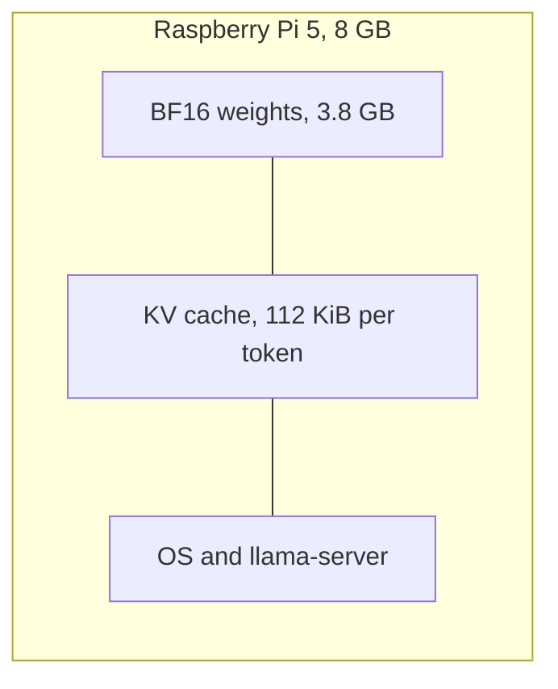
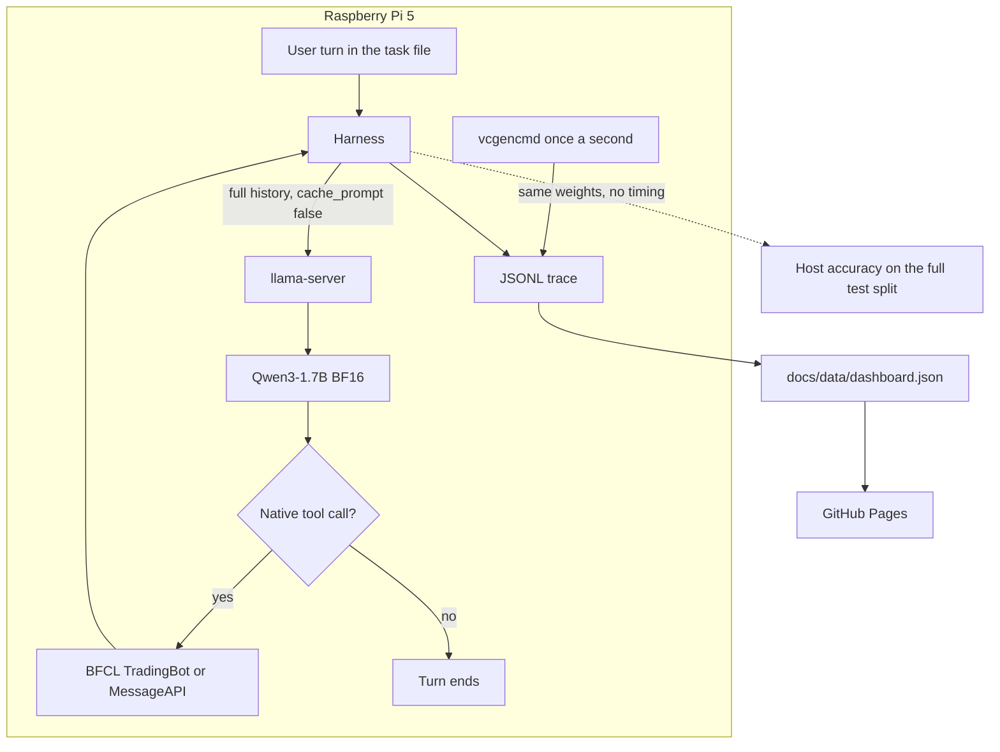
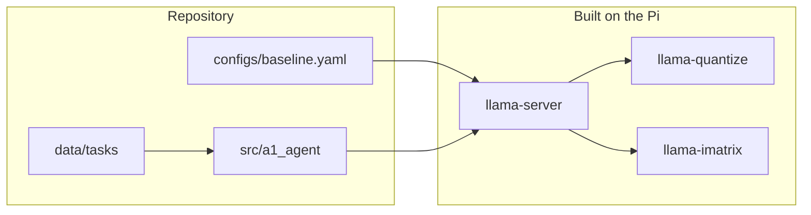
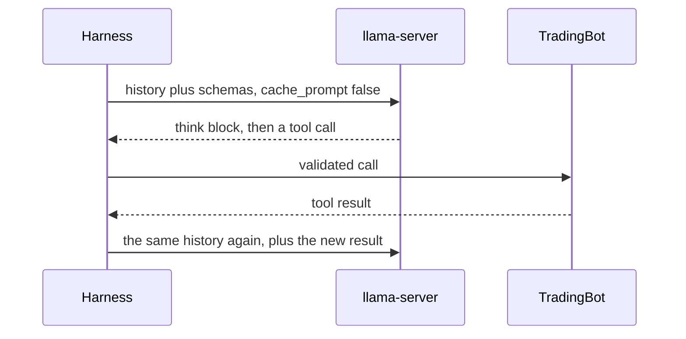
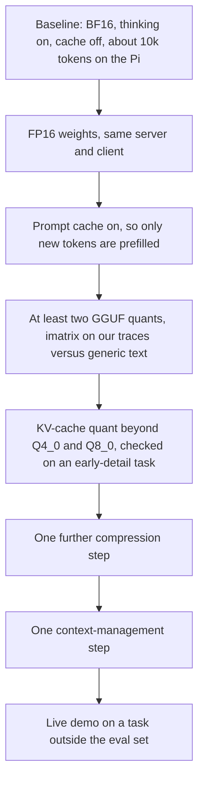

# Long Context Tool-Calling Agent

AI624 · AI on Edge Devices · Fall 2026  
Track A — Project A1 · 8 GB Raspberry Pi 5

Wajahat Riaz  
26 Nov 2026

Dashboard: [wajahatriaz.github.io/g7a1-ai-edge-devices-project](https://wajahatriaz.github.io/g7a1-ai-edge-devices-project/)  
Operator notes: [README.md](../README.md)  
Course manual: [Project_Description_AI624_2026.pdf](Project_Description_AI624_2026.pdf)

This note is the talk. It states what the project is, how the Pi is set up, what the baseline is allowed to do, and which measurements are still open. Numbers from the 26 Nov run are labeled as in progress. They are not the finished baseline.

---

## 1. The problem

The agent is one Qwen3 model running entirely on the Pi. A user turn can ask for a tool. The tool runs locally. Its output is appended to the conversation. The next turn sends that whole conversation again, and the model must still emit a valid call.

Two things make this hard on 8 GB:

1. Tool output grows the prompt. With prefix caching off, every turn pays for the whole history again.
2. The KV cache grows with context. Qwen3-1.7B keeps full attention in every layer, so the cache is linear in tokens and does not have a sliding-window layer to hide behind.

Out of scope: more than one agent, and a model that is served from another machine. Accuracy for the full test split may be scored on a host. Latency, memory, energy, and temperature are measured here.

---

## 2. What has to fit in 8 GB

Qwen3-1.7B is a dense model: 28 layers, 16 query heads, 8 KV heads, head dimension 128, context length 32,768 in the technical report [Qwen Team, 2025](https://arxiv.org/abs/2505.09388). The course manual uses that shape for the cache:

| Piece | Size |
|---|---|
| BF16 weights | about 3.8 GB |
| KV cache, 16-bit | 2 × 28 layers × 8 KV heads × 128 × 2 bytes = 112 KiB/token |
| KV at 8,192 tokens | about 0.9 GB |
| KV at 16,384 tokens | about 1.75 GB |
| KV at 32,768 tokens | about 3.5 GB |

BF16 weights plus a 32k cache do not fit in 8 GB with the OS. The manual's nominal baseline cache is 16k. The server running on this Pi uses `-c 8192` and one slot (`-np 1`). The default of four slots would reserve four 8192-token caches and slow the BF16 run down.



---

## 3. Requirements

The manual splits the work into a baseline and a sequence of changes. Each kept change is measured again on the same held-out split.

| Step | What it is | When |
|---|---|---|
| Baseline | Qwen3-1.7B BF16, stateless client, all schemas in the system prompt, unconstrained serving build, prefix cache off | Week 1, 29 Nov 2026 |
| Tasks | 20–30 BFCL multi-turn tools, TradingBot included, long-context mode, sessions of 10k–20k tokens, at least five tasks aimed at 16k–32k, at least two that need a detail from early in the session, a held-out test split | Week 1 |
| Harness | Tokens sent and reprocessed, prefill, decode, tool time, call validity | Week 1 |
| Characterization | Prefill and decode at three or more lengths, memory breakdown, a bandwidth check, wall clock per turn and per session | Week 1 |
| Serving | Thread placement, then prompt caching so only new tokens are processed. Same chat template as the baseline | Week 2, 6 Dec 2026 |
| Quantization | At least two GGUF formats, an importance matrix built on our own traces versus generic text, and a KV-cache format beyond plain Q4_0 or Q8_0 | Week 2 |
| Compression | One further step: pruning, distillation, LoRA, or outlier suppression | Final, 20 Dec 2026 |
| Context | One context-management step | Final |
| Demo | A CLI or web chat on a task that is not in the eval set | Final, viva 20 Dec |
| Report | Code and write-up | 24 Dec 2026 |

Every change reports session success, call validity, per-turn latency by component, cold and warm time to first call, peak memory, energy per session, and thermal state.

---

## 4. System



One request does this:

1. The harness builds the chat: system prompt with all 30 schemas, then the full history.
2. `llama-server` prefills that prompt and decodes until a tool call or the end of the turn. Thinking is on, so the decode includes the think block.
3. A tool call is checked for a known name and the required arguments, then executed in the BFCL backend.
4. The tool result is appended. The next request sends the history again.

The Web UI at `http://127.0.0.1:8080/` is the same server. It is for a live demo later, on a task outside the eval set.

---

## 5. Infrastructure

| Item | What this project uses |
|---|---|
| Board | Raspberry Pi 5 Model B Rev 1.0, 8 GB, 4 cores. Kernel `6.18.60+rpt-rpi-2712`. Hostname `g7a1-machine`. |
| Runtime | [llama.cpp](https://github.com/ggml-org/llama.cpp) `d1eb0de`, built here with `GGML_NATIVE=ON`, Release. Binaries in `build/llama.cpp/bin/`. |
| Server | `llama-server -m models/qwen3-1.7b-bf16.gguf -c 8192 --jinja --webui -t 2 -tb 4 -np 1 --host 127.0.0.1 --port 8080` |
| Flash attention | Left at the server default, `--flash-attn auto`. The build enables it unless the architecture forces it off. |
| Weights | [Qwen/Qwen3-1.7B](https://huggingface.co/Qwen/Qwen3-1.7B), converted locally to `models/qwen3-1.7b-bf16.gguf`. The official GGUF repository ships Q8_0. That file is not the baseline. |
| Tools | [Berkeley Function Calling Leaderboard](https://github.com/ShishirPatil/gorilla) via `third_party/gorilla`. Imported through a `.pth` file so the venv does not install the full BFCL dependency tree. |
| Harness | `src/a1_agent`, Python 3, `requests` and `PyYAML` in `.venv`. Converter deps live in `.venv-convert`. |
| Power | `vcgencmd pmic_read_adc`. Paired `NAME_A` current with `NAME_V` voltage. `EXT5V` and `BATT` have voltage only and are not turned into watts. |
| Heat | `vcgencmd measure_temp` and `vcgencmd get_throttled`. |
| Dashboard | `docs/index.html` and `docs/data/dashboard.json`, published from `/docs` on `main`. |



`llama-quantize` and `llama-imatrix` are built. They are not part of the baseline measurement.

---

## 6. Tasks and tools

Configured in `configs/tool_subset.json`.

| Backend | Tools | Why it is here |
|---|---|---|
| TradingBot | 20 | Required. Orders, watchlist, account, and transaction history. |
| MessageAPI | 10 | Second backend, so the subset is 30 tools. |

Source file: `BFCL_v4_multi_turn_long_context.json`. A task is kept when its classes are a subset of `{TradingBot, MessageAPI}` and TradingBot is present. `scripts/prepare_tasks.py` writes the splits.

| Split | Count | Path |
|---|---|---|
| BFCL tasks kept | 33 | |
| Train | 26 | `data/tasks/train.jsonl` |
| Test, held out | 12 | `data/tasks/test.jsonl` |
| Project long tasks | 5 | `data/tasks/long_extra.jsonl` |
| Early-detail tasks in the test split | 2 | `long_extra_01_binding_card`, `long_extra_02_early_order` |

The Pi timing run uses `long_extra_04_watchlist`: two user turns. The first asks for `get_transaction_history`, `get_watchlist`, and adding `MSFT`. The second asks for `get_watchlist` again. The harness is started without `--long-context`, so this session does not append the filler lists.

The full 12-task test split is `./scripts/run_host_accuracy.sh` on a host.

### TradingBot filler

In long-context mode, some TradingBot tools append made-up records after the real ones. Qwen3's tokenizer gives each digit its own token [Qwen Team, 2025](https://arxiv.org/abs/2505.09388), so those lists dominate the prompt. A course note measured:

| Call | Uncapped | After the cap |
|---|---|---|
| `get_stock_info` | about 31.6k tokens | about 7.9k tokens |
| `get_transaction_history` | about 49.3k tokens | about 4.9k tokens |
| TradingBot session, tool context only | median 32–36k, max about 67k | median 8–11k, max about 18k |

Other BFCL backends in that note stayed near a 3k-token median. The project description's ~11k figure matches the capped dumps, not the uncapped ones.

`setup.sh` appends this to `long_context.py` when it is missing:

```python
MA_5_EXTENSION = MA_5_EXTENSION[:500]
MA_20_EXTENSION = MA_20_EXTENSION[:500]
WATCH_LIST_EXTENSION = WATCH_LIST_EXTENSION[:500]
TRANSACTION_HISTORY_EXTENSION = TRANSACTION_HISTORY_EXTENSION[:100]
```

There is one copy on this machine. `import bfcl_eval` and the harness both resolve to `third_party/gorilla/.../func_source_code/long_context.py`. Patching a second install and leaving this one alone would make a correct trace fail the checker. The filler is not stored in the account. Replaying the ground truth for the TradingBot long-context tasks with and without the cap did not change final state, per that course note. A local call of `get_stock_info("AAPL")` after the cap returned 7,983 characters.

---

## 7. Baseline protocol

`configs/baseline.yaml` is the baseline. Later experiments change one thing at a time and say whether the change was kept.

| Setting | Baseline value | Why |
|---|---|---|
| Weights | `models/qwen3-1.7b-bf16.gguf` | Manual baseline. FP16 is the first listed improvement, not a replacement of this file. |
| Context | 8192 on this Pi | 16k is the manual's nominal cache. 8192 is what the running server was started with. |
| `cache_prompt` | false | `llama-server` caches prefixes unless the client refuses. The baseline must resend and reprocess the full history. |
| Schemas | all 30, in the system prompt, and also passed as tools | The model emits native `tool_calls`. The schemas still satisfy the baseline rule. |
| Thinking | on | Chat-template default. With thinking off, the model logged in, said it would fund the account, and ended the turn without `fund_account`. With thinking on, the same task called `fund_account(amount=2203.4)`. |
| Sampling | temperature 0.6, top-p 0.95, top-k 20 | Qwen's thinking-mode recommendation, also what the BFCL Qwen handler in this tree uses. Non-thinking, if compared later, is 0.7 / 0.8 / 20. |
| `max_tokens` | 2048 | 512 ended the turn inside the think block. |
| Grammar | off | No constrained decoding in the baseline. |
| Threads | `-t 2`, `-tb 4`, `-np 1` | One slot. Four slots reserved four KV caches. |



Sessions that process much more than about 10k tokens are too long for this baseline. An earlier stateless run of `long_extra_03_fund_after_dump` reached about 36k tokens at about 1.4 tok/s, which is about 7 hours. That task is not in `./scripts/run_baseline.sh`. The Pi script is:

1. `long_extra_04_watchlist`
2. Prefill and decode at 512, 2048, and 4096 prompt tokens, 32 tokens decoded at each length

`./scripts/sample_device.sh` wraps both steps. `./scripts/export_dashboard.sh` writes `docs/data/dashboard.json`.

---

## 8. What a run records

| Record | Where it comes from |
|---|---|
| Prompt tokens, cached tokens, generated tokens | llama-server timings, via the harness |
| Prefill ms, decode ms, tool ms, wall ms | harness, per turn |
| Call validity | known tool name and required arguments |
| Session success | task checks such as balance, watchlist membership, early-detail recall |
| Power | sum of paired PMIC rails, trapezoid integral over the trace |
| Temperature and throttle | `measure_temp`, `get_throttled` |
| Peak memory | `llama-server` high-water RSS, not the whole board |
| Bandwidth check | bytes moved per token times decode tok/s, compared with a measured memory bandwidth. Not computed until a sweep finishes. |

Throttle bits 0–3 are the current state: under-voltage, frequency capped, throttled, soft temperature limit. Bits 16–19 are sticky since boot. `0x80000` means the soft limit happened earlier. It does not by itself discard a run. `0xe0006` means frequency is capped and the CPU is throttled now, and those events have also been sticky since boot.

The dashboard keeps runs by date. A later run of the same kind is compared with the previous one: lower prefill and decode is better, higher tok/s is better.

---

## 9. The 26 Nov run, unfinished

`./scripts/run_baseline.sh` was started at 11:39 PKT on 26 Nov 2026. Archive: `results/baseline/history/2026-11-26T06-39-36Z`. When this note was written the watchlist task was still on its first prefill. No session file had been written. The sweep had not started.

Snapshot from the server log at 2048 processed tokens:

| Observation | Value |
|---|---|
| Prompt progress | 0.37, so the prompt is about 5,500 tokens |
| Prefill rate | 2048 tokens in 3839 s, **0.53 tok/s** |
| Temperature | 93–95°C |
| Throttle | `freq_capped` and `throttled` now |
| Power | about 2.9–3.8 W while throttled |
| Start temperature | 74.7°C, no active throttle, about 3.6 W |

0.53 tok/s is slower than the 1.4 tok/s of the earlier 36k-token run. The Pi was thermally limited. BF16 is still the suspected cause of the low rate relative to FP16, which has faster instructions on this CPU. That conversion is not part of this run.

At 0.53 tok/s the rest of the script is hours, not a short smoke test. A finish time depends on whether the model emits the three watchlist calls in one reply or one at a time, because each reply prefills the history again.

---

## 10. Experiment lineage

Nothing below the baseline has been run. The order is the one the manual requires, with the two changes the course notes put first.



Quantization is expected to hurt thinking more than a short tool call. At each format, compare thinking and non-thinking, and report the accuracy gap against this thinking-on baseline. Non-thinking sampling is temperature 0.7, top-p 0.8, top-k 20.

A reference for recovering tool use after compression is Kovalenko and Redchych, [Small Agents Should Know What Their Tools Do](https://arxiv.org/abs/2610.35981). They train LoRA adapters on Qwen3-1.7B and Qwen3-4B. If we use that path, the traces should include thinking, because that is the baseline mode.

Prompt caching stays off until the baseline numbers exist. Flash attention stays at `auto` unless a later measurement shows it is off.

---

## 11. Checklist

### Done

- [x] Pi 5 build of llama-server, llama-cli, llama-quantize, llama-imatrix
- [x] Qwen3-1.7B converted to BF16 GGUF and served on the Pi
- [x] 30-tool subset, 26/12 split, five extra tasks, two early-detail tasks held out
- [x] Harness with call checks, `cache_prompt: false`, schemas in the prompt
- [x] Thinking on and Qwen thinking-mode sampling
- [x] TradingBot filler cap in the shared `long_context.py`
- [x] Continuous power, temperature, throttle, and RSS sampler
- [x] Dated dashboard

### Open for Week 1

- [ ] Finish the watchlist session and the 512 / 2048 / 4096 sweep
- [ ] Report prefill and decode, peak RSS, energy, and whether the run was throttled
- [ ] Bandwidth check: bytes per token times tok/s against measured bandwidth
- [ ] Score the 12-task test split on a host with the same weights
- [ ] Say, in the talk, that anything well above about 10k processed tokens is too slow for this BF16 stateless baseline

### Open after Week 1

- [ ] FP16 as the first speed experiment
- [ ] Prompt caching, same chat template
- [ ] Two or more GGUF formats, imatrix on our traces, KV-cache quant
- [ ] Thinking versus non-thinking at each quant level
- [ ] One more compression step and one context-management step
- [ ] Demo on a task outside the trace set
- [ ] Written report, 24 Dec 2026

---

## 12. Talk outline

1. One model on an 8 GB Pi, multi-turn tools, history resent every turn. (Sections 1–2.)
2. Show the memory table. 32k BF16 does not fit. We serve 8192. (Section 2.)
3. Walk the request diagram: harness, server, BFCL, sampler. (Section 4.)
4. Baseline rules: BF16, thinking on, Qwen sampling, cache off. The `fund_account` failure is the reason thinking stays on. (Section 7.)
5. TradingBot digits. Uncapped dumps are 30k–50k tokens. The cap brings them back toward the manual. (Section 6.)
6. The 26 Nov prefill: 0.53 tok/s at 93–95°C, throttled. This is why the Pi script stays near 10k tokens, and why FP16 is first. (Section 9.)
7. Checklist: what is built, what the Week 1 number still has to be. (Section 11.)
8. Lineage slide, and stop. Do not claim quantization or caching results. (Section 10.)

---

## 13. References

1. Qwen Team. *Qwen3 Technical Report.* arXiv:2505.09388, 2025. <https://arxiv.org/abs/2505.09388>. Model card and thinking-mode sampling: <https://huggingface.co/Qwen/Qwen3-1.7B>.
2. ggml-org. *llama.cpp.* Commit `d1eb0de` in this project. <https://github.com/ggml-org/llama.cpp>.
3. Shishir G. Patil, Huanzhi Mao, Fanjia Yan, Charlie Cheng-Jie Ji, Vishnu Suresh, Ion Stoica, and Joseph E. Gonzalez. *The Berkeley Function Calling Leaderboard (BFCL): From Tool Use to Agentic Evaluation of Large Language Models.* Proceedings of the 42nd International Conference on Machine Learning, PMLR 267, pages 48371–48392, 2025. <https://proceedings.mlr.press/v267/patil25a.html>. Multi-turn category notes: <https://gorilla.cs.berkeley.edu/blogs/13_bfcl_v3_multi_turn.html>. Code: <https://github.com/ShishirPatil/gorilla>.
4. Alexander Kovalenko and Artem Redchych. *Small Agents Should Know What Their Tools Do.* arXiv:2610.35981, 2026. <https://arxiv.org/abs/2610.35981>.
5. Edward J. Hu, Yelong Shen, Phillip Wallis, Zeyuan Allen-Zhu, Yuanzhi Li, Shean Wang, Lu Wang, and Weizhu Chen. *LoRA: Low-Rank Adaptation of Large Language Models.* arXiv:2106.09685, 2021. <https://arxiv.org/abs/2106.09685>.
6. Raspberry Pi Ltd. *Raspberry Pi 5.* <https://www.raspberrypi.com/products/raspberry-pi-5/>.
7. AI624 course manual, Fall 2026, Track A, Project A1. [Project_Description_AI624_2026.pdf](Project_Description_AI624_2026.pdf). The TradingBot token counts in Section 6 are from the course note on long-context filler, not from a finished run of this repo.
